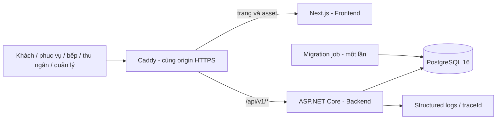

# ADR-0002 — Kiến trúc và cấu trúc dự án

> Cập nhật triển khai02/11/2026: bản MVP localhost đã chạy. [ADR-0008](0008-mvp-local-va-quyet-dinh-trien-khai.md) thay thế các lựa chọn/giới hạn khác biệt bên dưới; [API thực thi](../docs/api/README.md) và [trạng thái](../docs/IMPLEMENTATION-STATUS.md) là bằng chứng hiện tại. Phần ghi chưa triển khai ở nội dung gốc mô tả thời điểm thiết kế ban đầu.

Ngày 02/11/2026 · Thiết kế baseline; cây dưới đây **chưa được khởi tạo** ngoài các file Markdown bàn giao.

## 1. Quyết định

Modular monolith: một ASP.NET API, một PostgreSQL, một Next.js server. Chia module theo bảy SSOT; không chia database/service theo phân hệ. Một transaction có thể hoàn tất order/payment/visit mà không cần distributed transaction. Một instance API ở MVP; scale nhiều instance cần xem lại rate limit và auth key sharing.



Browser chỉ gọi `/api/v1` cùng origin. Caddy chuyển API nguyên path tới `backend:8080`; đường còn lại tới `frontend:3000`. Next.js SSR cần đọc dữ liệu dùng URL nội bộ `http://backend:8080` và forward cookie đúng ngữ cảnh, không đưa địa chỉ nội bộ vào biến `NEXT_PUBLIC_*`. Dữ liệu lượt/đơn `no-store`, không shared-cache/ISR giữa khách. Không gọi PostgreSQL trực tiếp từ frontend.

## 2. Phân lớp backend vừa đủ

API (transport, policy) → Application (use case/transaction) → Domain (state/rules). Infrastructure triển khai EF, phiên, clock, audit. Domain không phụ thuộc EF/HTTP/Next.js. Một DbContext, một Unit of Work bằng chính EF; không thêm generic repository bọc DbSet hoặc event bus phân tán.

Use case ghi là ranh giới transaction. Module gọi service nội bộ có type rõ; không gọi HTTP sang chính mình. Quy tắc feature dẫn mã BR từ SSOT; các invariant liên bảng được bảo vệ ở migration/DB như ADR-0003.

## 3. Cấu trúc mục tiêu

```text
Repo/
├── README.md
├── SSOT/                         # 7 đặc tả nghiệp vụ duy nhất + index
├── ADR/                          # quyết định, data dictionary, roadmap
├── temp-docs/                    # đầu vào lịch sử, giữ nguyên
├── Backend/                      # đúng folder đã có
│   ├── README.md
│   ├── RestaurantOrdering.sln
│   ├── global.json               # SDK 10 khóa patch đã kiểm tra
│   ├── Directory.Packages.props
│   ├── packages.lock.json        # từng project nếu NuGet tạo riêng
│   ├── src/
│   │   ├── Restaurant.Api/       # endpoints, auth, health, middleware
│   │   ├── Restaurant.Application/
│   │   │   ├── Accounts/
│   │   │   ├── Menu/
│   │   │   ├── Visits/
│   │   │   ├── Ordering/
│   │   │   ├── Kitchen/
│   │   │   ├── Serving/
│   │   │   └── Billing/
│   │   ├── Restaurant.Domain/    # entities, states, domain policies
│   │   └── Restaurant.Infrastructure/
│   │       ├── Persistence/      # DbContext + Configurations
│   │       │   └── Migrations/   # EF migrations + snapshot
│   │       ├── Authentication/
│   │       └── Auditing/
│   ├── tests/
│   │   ├── Restaurant.UnitTests/
│   │   └── Restaurant.IntegrationTests/
│   ├── openapi/                  # export hợp đồng từ API
│   ├── postman/                  # collection tùy nhu cầu test
│   ├── Dockerfile                # SDK build, runtime api, migration target
│   └── .dockerignore
├── Frontend/                     # đúng folder đã có
│   ├── README.md
│   ├── package.json
│   ├── package-lock.json
│   ├── next.config.ts            # standalone container output
│   ├── src/
│   │   ├── app/
│   │   │   ├── (public)/         # menu, /qr/[token], tham gia lượt
│   │   │   ├── (customer)/       # /customer/order
│   │   │   ├── (staff)/          # /login, /waiter, /kitchen, /cashier
│   │   │   └── (management)/     # /manage/menu, /manage/tables, /admin/staff
│   │   ├── features/            # accounts/menu/visits/ordering/kitchen/serving/billing
│   │   ├── components/          # thành phần giao diện dùng chung
│   │   └── lib/                 # api client, error mapping, query keys
│   ├── public/menu/             # ảnh mẫu được quản lý trong repo
│   ├── tests/                   # unit UI và Playwright E2E
│   ├── Dockerfile
│   └── .dockerignore
├── compose.yml                  # stack demo/runtime, chưa tạo ở giai đoạn này
├── compose.dev.yml              # bind mount + watch/HMR
├── compose.test.yml             # DB riêng + test runners
├── .env.example                 # tên biến + ví dụ không có secret thật
├── .gitignore
└── ops/
    ├── Caddyfile
    └── README.md                # runbook, backup, restore, seed, demo
```

Route groups Next.js không tự bảo vệ quyền; backend vẫn policy bắt buộc. Mỗi feature có UI/query/mutation riêng, không trộn logic nghiệp vụ vào layout. Không tạo folder `backend/` thứ hai khác hoa thường hoặc nested `Frontend/frontend/`.

## 4. Quyền sở hữu module

| Module | Dữ liệu ghi chính | Phối hợp |
|---|---|---|
| Accounts | user/role/staff_session | Tất cả use case kiểm tra principal |
| Menu | category/menu_item | Ordering kiểm tra availability trong transaction |
| Visits | table/visit/guest_session | Mở lượt phối hợp tạo order, Billing đóng lượt |
| Ordering | order/batch/item trước chế biến | Duyệt và sửa/hủy, các module khác dùng policy chung |
| Kitchen | trạng thái ACCEPTED/PREPARING/READY | Ordering phê duyệt; Menu availability |
| Serving | trạng thái SERVED | Billing kiểm tra đã bàn giao |
| Billing | payment và chuyển order/visit kết thúc | Dùng chung transaction với Visits/Ordering |

Không tạo CRUD chung cho `order.status`/`item.status`. Mỗi transition là một use case có quyền, điều kiện, audit và kiểm thử.

## 5. Chất lượng và vận hành

Liveness `/health/live` không phụ thuộc DB; readiness `/health/ready` kiểm tra kết nối + schema hiện hành. Log JSON có traceId/requestId, không token/mật khẩu/join code. Time lưu UTC, UI hiển thị `Asia/Ho_Chi_Minh`; không hard-code giờ host. Money VND nguyên, API dùng số JSON trong giới hạn an toàn ADR-0003.

MVP không yêu cầu HA; volume bền và restore test quan trọng hơn tự động scale. HTTP localhost cho demo máy phát triển; demo qua điện thoại/LAN hoặc triển khai cần HTTPS hoặc cấu hình dev cookie được ghi rõ trong runbook. Không dùng cookie Secure với URL HTTP LAN rồi kết luận chức năng QR lỗi.
