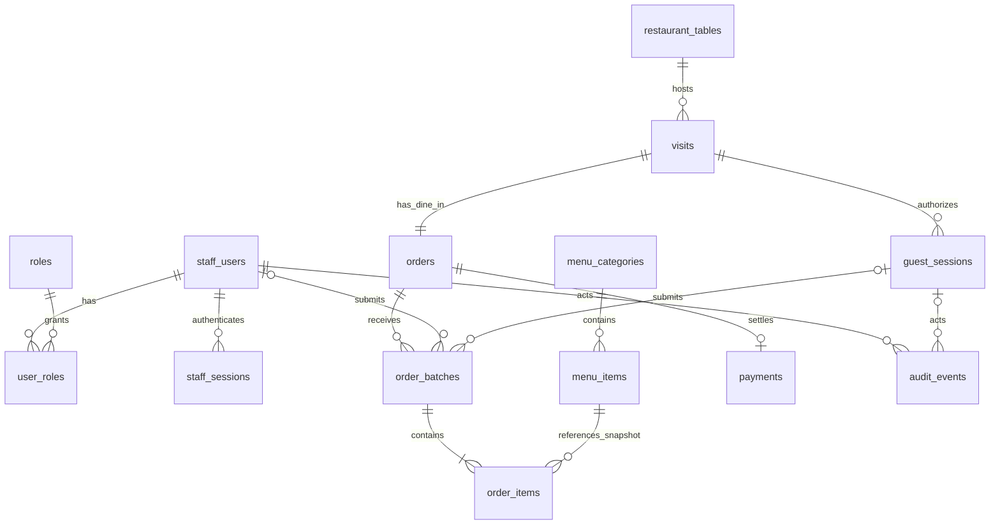

# ADR-0003 — Thiết kế PostgreSQL và từ điển dữ liệu

> Cập nhật triển khai02/11/2026: bản MVP localhost đã chạy. [ADR-0008](0008-mvp-local-va-quyet-dinh-trien-khai.md) và [ADR-0009](0009-qr-co-dinh-tai-ban.md) thay thế các lựa chọn/giới hạn khác biệt bên dưới; [API thực thi](../docs/api/README.md) và [trạng thái](../docs/IMPLEMENTATION-STATUS.md) là bằng chứng hiện tại. Phần ghi chưa triển khai ở nội dung gốc mô tả thời điểm thiết kế ban đầu.

Ngày 02/11/2026 · Thiết kế baseline v1.0 · **Chưa tạo database hoặc migration thực thi**. Đây là nguồn schema duy nhất ở giai đoạn thiết kế; khi triển khai, EF migrations/snapshot thể hiện schema thực và phải đồng bộ tài liệu này trong cùng PR.

## 1. Nguyên tắc và ký hiệu

- PostgreSQL 16; schema ứng dụng `public`, snake_case. UUID sinh bằng ứng dụng; không phụ thuộc extension UUID. Mọi FK mặc định `ON DELETE RESTRICT`, không cascade xóa lịch sử; các FK tùy chọn vẫn RESTRICT khi đã có giá trị.
- `NN` = NOT NULL; `NULL` = cho phép thiếu; `PK`, `UQ`, `FK` như SQL. Không ghi default nghĩa là **không có default**, caller phải cấp khi NN. `now()` là thời điểm transaction UTC lưu dưới `timestamptz`; không dùng timestamp thiếu múi giờ.
- Mọi chuỗi mã/tên/lý do NN phải `CHECK (btrim(value) <> '')`; varchar có giới hạn rõ. Chuỗi tùy chọn nếu có phải không trắng, UI gửi null thay chuỗi rỗng. Mã (`code`, username) canonical trim, chữ thường với username/chữ hoa với mã nghiệp vụ; DB CHECK canonical và UNIQUE theo giá trị canonical.
- Tiền là `bigint` VND nguyên: từng đơn giá/amount/tendered/total trong `[0, 1000000000000]` (10^12); tổng tính bằng numeric trong truy vấn rồi kiểm tra giới hạn trước cast. Không float, không cột currency vì MVP chỉ VND. JSON an toàn với JS Number trong giới hạn này.
- `version bigint NN DEFAULT 1 CHECK(version>0)` ở bảng mutable; EF cấu hình concurrency token, mỗi mutation thành công tăng đúng 1 và cập nhật `updated_at`. PostgreSQL trigger kiểm tra version tăng để tránh code quên; không dùng `xmin` làm hợp đồng API.
- Nhóm cột **M** dưới đây là các cột vật lý bắt buộc cho từng bảng được đánh dấu M: `id uuid PK NN` (app cấp), `created_at timestamptz NN DEFAULT now()`, `updated_at timestamptz NN DEFAULT now() CHECK(updated_at>=created_at)`, `version bigint NN DEFAULT 1 CHECK(version>0)`. Bảng không có M liệt kê đủ riêng, không tự thêm cột.
- `updated_at`/`status_changed_at` do server/DB cấp, không lấy từ payload. Các timestamp rời đi/thu hồi ≥ created_at; reviewer/time ≥ submitted_at. Không kiểm tra `now()` trong CHECK vì thời gian tiếp tục trôi.
- State lưu `varchar` + CHECK tập giá trị, không dùng PostgreSQL ENUM để dễ migration mở rộng. Trạng thái không có default trừ khi ghi rõ; use case tạo phải chỉ định đúng.

## 2. ERD



ERD thể hiện nhánh DINE_IN: mỗi visit đúng một order; takeaway là order không visit. Các quan hệ người duyệt, người mở, người thu ở từ điển bên dưới; không lược bỏ FK khi triển khai vì sơ đồ không vẽ hết. `audit_events.target_id` đa hình có chủ ý (mục 5), không giả làm FK.

## 3. Từ điển dữ liệu đầy đủ

### 3.1. `staff_users` — M · chủ sở hữu P1.1

| Cột ngoài M | Kiểu / null / default | Ý nghĩa / ràng buộc |
|---|---|---|
| username | varchar(64) NN UQ | Lowercase trim; mẫu `^[a-z0-9._-]{3,64}$` |
| display_name | varchar(120) NN | Tên hiển thị không trắng |
| password_hash | text NN | Hash có salt do PasswordHasher tạo, không hash tự viết |
| is_active | boolean NN DEFAULT true | Vô hiệu hóa thay xóa |
| must_change_password | boolean NN DEFAULT true | Chỉ auth/me/change-password/logout khi true |

Không bắt buộc email/điện thoại/ngày sinh/địa chỉ vì không có nghiệp vụ sử dụng. Giới hạn số lần đăng nhập bằng rate limiter, không lưu thêm counter chưa cần thiết. Role cuối cùng kiểm tra theo transaction ở mục 5.

### 3.2. `roles` — danh mục cố định · P1.1

| Cột | Kiểu / null / default | Ràng buộc |
|---|---|---|
| code | varchar(16) PK NN | CHECK IN ('WAITER','KITCHEN','CASHIER','MANAGER','ADMIN') |
| display_name | varchar(80) NN | Không trắng |

Seed đúng 5 role nhân viên, không CUSTOMER. Không CRUD role/permission động ở MVP. Không có M/version vì danh mục bất biến, chỉ thay qua migration.

### 3.3. `user_roles` — P1.1

| Cột | Kiểu / null / default | Ràng buộc |
|---|---|---|
| user_id | uuid NN FK staff_users(id) | PK(user_id, role_code) |
| role_code | varchar(16) NN FK roles(code) | Chống cấp trùng role |
| granted_at | timestamptz NN DEFAULT now() | Thời điểm cấp |
| granted_by_staff_id | uuid NULL FK staff_users(id) | NULL duy nhất cho bootstrap admin; những thay đổi runtime bắt buộc có actor và audit |

Index `(role_code,user_id)` cho tìm ADMIN cuối cùng. Không lưu role list JSON trong user.

### 3.4. `staff_sessions` — phiên opaque · P1.1

| Cột | Kiểu / null / default | Ràng buộc |
|---|---|---|
| id | uuid PK NN | App sinh |
| user_id | uuid NN FK staff_users(id) | Chủ phiên |
| token_hash | bytea NN UQ | SHA-256 token ≥256 bit; CHECK octet_length=32 |
| created_at | timestamptz NN DEFAULT now() | Lúc login |
| expires_at | timestamptz NN | >created_at; chính sách 8 giờ tuyệt đối |
| revoked_at | timestamptz NULL | NULL hoặc ≥created_at |

Index `(user_id) WHERE revoked_at IS NULL`, `(expires_at)`. Không lưu token thô, refresh token hoặc role snapshot. Không cần version vì chỉ thao tác thu hồi idempotent; không un-revoke. Reset password thu hồi tất cả phiên theo user_id.

### 3.5. `menu_categories` — M · P1.2

| Cột ngoài M | Kiểu / null / default | Ràng buộc |
|---|---|---|
| code | varchar(32) NN UQ | Mã uppercase canonical |
| name | varchar(100) NN | Không trắng |
| sort_order | integer NN DEFAULT 0 | CHECK >=0 |
| is_active | boolean NN DEFAULT true | Danh mục ẩn chặn gọi mới |

Index `(is_active,sort_order,id)` cho menu. Không parent_category vì chưa có phân cấp.

### 3.6. `menu_items` — M · P1.2

| Cột ngoài M | Kiểu / null / default | Ràng buộc |
|---|---|---|
| category_id | uuid NN FK menu_categories(id) | Một danh mục/món |
| code | varchar(32) NN UQ | Mã uppercase canonical, không tái sử dụng |
| name | varchar(160) NN | Không trắng; không UNIQUE tên vì có thể trùng tên hợp lệ |
| description | varchar(2000) NN | Mô tả không trắng |
| image_url | varchar(2048) NN | `/menu/...` hoặc HTTPS; validate allowlist/path ở server, không traversal |
| price_vnd | bigint NN | CHECK 0..10^12 |
| is_active | boolean NN DEFAULT true | Hiển thị |
| is_available | boolean NN DEFAULT true | Còn/hết |

Index `(category_id,is_active,id)`, có thể thêm tìm kiếm tên khi đo được nhu cầu, chưa thêm pg_trgm. DB không xác minh ảnh tồn tại; UI dùng fallback. Code ảnh nội bộ không cho scheme bất kỳ.

### 3.7. `restaurant_tables` — M · P1.3

| Cột ngoài M | Kiểu / null / default | Ràng buộc |
|---|---|---|
| code | varchar(20) NN UQ | Mã bàn uppercase canonical |
| capacity | smallint NN | CHECK BETWEEN 1 AND 30 (giới hạn MVP có thể đổi qua migration) |
| is_active | boolean NN DEFAULT true | Không mở lượt mới nếu false |
| qr_token_hash | bytea NN UQ | SHA-256 token ≥256 bit, length=32 |
| qr_token_ciphertext | bytea NULL | Token mã hóa Data Protection để xem lại QR cố định; NULL chỉ cho nâng cấp trước seed backfill; nếu có thì length>0 |

QR được xem lại qua API nhân viên từ ciphertext, không cần xoay để in lại. Seed backfill một lần cho bàn cũ chưa có ciphertext; các lần sau giữ nguyên. Keyring auth_keys phải giữ cùng DB. Không stored occupied/table_status. Không đổi code khi đang có lượt OPEN; bàn đã có lịch sử không xóa. Không bắt capacity mới nhỏ hơn party_size lượt mở.

### 3.8. `visits` — M · P1.3

| Cột ngoài M | Kiểu / null / default | Ràng buộc |
|---|---|---|
| table_id | uuid NN FK restaurant_tables(id) | Bàn của lượt |
| table_code_snapshot | varchar(20) NN | Mã bàn lúc mở; giữ lịch sử khi đổi mã về sau |
| status | varchar(12) NN | CHECK IN ('OPEN','CLOSED','CANCELLED') |
| party_size | smallint NN | CHECK 1..30; service/trigger kiểm ≤ table.capacity lúc mở |
| opened_by_staff_id | uuid NN FK staff_users(id) | Người mở |
| ended_at | timestamptz NULL | OPEN ⇔ NULL; CLOSED/CANCELLED ⇔ NN và ≥created_at |
| ended_by_staff_id | uuid NULL FK staff_users(id) | OPEN ⇔ NULL; kết thúc ⇔ NN |

Unique partial `(table_id) WHERE status='OPEN'` là ràng buộc chống hai lượt mở. Không còn mã tham gia/HMAC/generation từ migration003; guest chỉ gắn visit và revoke/expiry. Mở lượt/QR không cập nhật created_at của bàn.

### 3.9. `guest_sessions` — P1.3

| Cột | Kiểu / null / default | Ràng buộc |
|---|---|---|
| id | uuid PK NN | App sinh |
| visit_id | uuid NN FK visits(id) | Phạm vi quyền |
| token_hash | bytea NN UQ | SHA-256 token ≥256 bit, length=32 |
| created_at | timestamptz NN DEFAULT now() | Lúc tham gia |
| expires_at | timestamptz NN | >created_at; 12 giờ |
| revoked_at | timestamptz NULL | NULL hoặc ≥created_at |

Index `(visit_id) WHERE revoked_at IS NULL`, `(expires_at)`. Request kiểm visit vẫn OPEN + chưa hết hạn/chưa thu hồi. Khách join bằng QR cố định, không mã nhập. Không lưu thiết bị fingerprint, tên khách hay IP lâu dài. Hết hạn có thể nhập lại mã nếu visit còn mở; cấp session mới không mở order mới.

### 3.10. `orders` — M · P1.4/P1.7

| Cột ngoài M | Kiểu / null / default | Ràng buộc |
|---|---|---|
| code | varchar(32) NN UQ | Mã order ngẫu nhiên dễ đọc, không dùng max+1 |
| order_type | varchar(12) NN | CHECK IN ('DINE_IN','TAKEAWAY') |
| visit_id | uuid NULL FK visits(id), UQ | DINE_IN ⇔ NN; TAKEAWAY ⇔ NULL |
| pickup_code | varchar(16) NULL UQ | TAKEAWAY ⇔ NN, DINE_IN ⇔ NULL; random có retry khi collision |
| pickup_name | varchar(120) NULL | Chỉ TAKEAWAY; tên nhận không trắng nếu có |
| status | varchar(20) NN | CHECK IN ('SERVING','AWAITING_PAYMENT','PAID','CANCELLED') |
| total_vnd | bigint NULL | NN iff AWAITING_PAYMENT/PAID, trong 0..10^12; SERVING/CANCELLED phải NULL |
| created_by_staff_id | uuid NN FK staff_users(id) | Nhân viên mở lượt/tạo takeaway |
| status_changed_at | timestamptz NN DEFAULT now() | >=created_at; lần chuyển trạng thái gần nhất |

`UNIQUE(visit_id)` cho phép nhiều NULL của takeaway theo PostgreSQL mặc định. Không lưu table_id để tránh lệch visit/table; không lưu customer_id giả. Không `paid_at`, `closed_at` trùng payment.paid_at/visit.ended_at. `order.code`/type/visit/pickup_code bất biến sau tạo. Index `(status,created_at,id)`, `(order_type,status,created_at,id)` nếu query sử dụng; code/pickup_code đã có UQ index.

### 3.11. `order_batches` — M · P1.4

| Cột ngoài M | Kiểu / null / default | Ràng buộc |
|---|---|---|
| order_id | uuid NN FK orders(id) | Order cha |
| sequence_no | integer NN | CHECK >0; UQ(order_id,sequence_no); MAX+1 chỉ sau khóa order |
| status | varchar(12) NN | CHECK IN ('PENDING','APPROVED','REJECTED','WITHDRAWN') |
| submitted_by_staff_id | uuid NULL FK staff_users(id) | XOR với guest |
| submitted_by_guest_session_id | uuid NULL FK guest_sessions(id) | Chỉ order tại bàn, guest.visit_id = order.visit_id |
| reviewed_by_staff_id | uuid NULL FK staff_users(id) | APPROVED sequence>1 hoặc REJECTED bắt buộc có; còn lại NULL |
| reviewed_at | timestamptz NULL | Đi cùng reviewed_by; >=created_at |
| decision_reason | varchar(500) NULL | REJECTED bắt buộc không trắng; các trạng thái khác NULL |
| eligible_at | timestamptz NULL | APPROVED iff NN; thời điểm vào queue: sequence1=created_at, sequence>1=reviewed_at |

created_at chính là submitted_at, không thêm cột trùng. XOR `num_nonnulls(submitted_by_staff_id,submitted_by_guest_session_id)=1`. PENDING/REJECTED/WITHDRAWN eligible_at NULL. Sequence 1 chỉ APPROVED (tự động), không có reviewed actor/time/reason; hủy hết dòng vẫn giữ APPROVED. Sequence>1 APPROVED cần reviewer; nếu reviewer trùng submitted_by_staff_id thì cần MANAGER/ADMIN theo xác nhận2B. REJECTED cần reviewer/time/reason. PENDING/WITHDRAWN không reviewer/time/reason; người rút/lý do nếu có trong audit. Ít nhất 1 và ≤50 item/batch bằng trigger deferred/command validation.

Index partial `(created_at,id) WHERE status='PENDING'`; `(order_id,created_at,id)`. Không trường `is_additional` vì suy ra sequence>1. Không lưu order.total pending để tránh dữ liệu tổng trùng.

### 3.12. `order_items` — M · P1.4/P1.5/P1.6

| Cột ngoài M | Kiểu / null / default | Ràng buộc |
|---|---|---|
| batch_id | uuid NN FK order_batches(id) | Suy ra order qua batch, không lưu thêm order_id |
| menu_item_id | uuid NN FK menu_items(id) | Tham chiếu danh mục gốc |
| menu_code_snapshot | varchar(32) NN | Mã món lúc gửi |
| menu_name_snapshot | varchar(160) NN | Tên món lúc gửi |
| quantity | smallint NN | CHECK BETWEEN 1 AND 99 |
| unit_price_vnd | bigint NN | CHECK 0..10^12; snapshot từ menu lúc gửi |
| note | varchar(500) NULL | Ghi chú; không trắng nếu có |
| status | varchar(20) NN | CHECK IN ('PENDING_APPROVAL','PLACED','ACCEPTED','PREPARING','READY','SERVED','CANCELLED','REJECTED') |
| status_changed_at | timestamptz NN DEFAULT now() | >=created_at; khi đang READY chính là readyAt |

Không UNIQUE(batch_id,menu_item_id): cùng món có thể khác ghi chú. Không line_total lưu trùng; SELECT quantity::numeric * unit_price_vnd. Snapshot/mapping/batch bất biến sau tạo; chỉ quantity giảm/note sửa trước chuẩn bị. History giá trị cũ và từng trạng thái ở audit_events, không thêm hàng loạt cột accepted_at/preparing_at/... trùng history. Chuyển status phải ghi status_changed_at và version; sửa note/quantity chỉ đổi updated_at/version.

Index `(batch_id,id)`, `(menu_item_id)`; partial `(status,status_changed_at,id) WHERE status IN ('PLACED','ACCEPTED','PREPARING','READY')`. KDS sort JOIN batch.eligible_at + item.created_at/id; serving sort item.status_changed_at. Không cần denormalize eligible_at vào item ở tải 50 thiết bị.

### 3.13. `payments` — bất biến · P1.7

| Cột | Kiểu / null / default | Ràng buộc |
|---|---|---|
| id | uuid PK NN | App sinh |
| order_id | uuid NN UQ FK orders(id) | Tối đa một thanh toán/order |
| receipt_no | varchar(32) NN UQ | Mã biên nhận random, không max+1 |
| method | varchar(16) NN | CHECK IN ('CASH','BANK_TRANSFER','ZERO') |
| amount_vnd | bigint NN | CHECK 0..10^12; phải bằng orders.total_vnd khi commit |
| tendered_vnd | bigint NULL | CASH iff NN; >=amount và ≤10^12 |
| transfer_reference | varchar(120) NULL | BANK_TRANSFER iff NN không trắng; không UQ vì nội dung chuyển tiền có thể trùng |
| paid_at | timestamptz NN DEFAULT now() | Thời điểm xác nhận thực nhận |
| received_by_staff_id | uuid NN FK staff_users(id) | CASHIER/MANAGER/ADMIN tại thời điểm thực hiện |

ZERO ⇔ amount=0, tendered và reference NULL. CASH/BANK_TRANSFER ⇔ amount>0. CASH reference NULL; BANK_TRANSFER tendered NULL. `change_vnd` là giá trị SELECT/API `tendered_vnd - amount_vnd`, không cột lưu. Không payment status PENDING giả vì không có gateway; chỉ ghi sau khi nhân viên xác nhận đã nhận tiền. Không UPDATE/DELETE cho app role. Index `(paid_at,id)` phục vụ lịch sử/đối soát cơ bản.

### 3.14. `audit_events` — append-only · dùng chung

| Cột | Kiểu / null / default | Ràng buộc |
|---|---|---|
| id | uuid PK NN | App sinh |
| occurred_at | timestamptz NN DEFAULT now() | Server time |
| actor_kind | varchar(8) NN | CHECK IN ('STAFF','GUEST','SYSTEM') |
| actor_staff_id | uuid NULL FK staff_users(id) | STAFF iff NN; các loại khác NULL |
| actor_guest_session_id | uuid NULL FK guest_sessions(id) | GUEST iff NN; các loại khác NULL |
| action | varchar(64) NN | Danh mục mã hành động trong ứng dụng; không trắng |
| target_type | varchar(32) NN | CHECK IN ('STAFF_USER','USER_ROLE','MENU_CATEGORY','MENU_ITEM','TABLE','VISIT','GUEST_SESSION','ORDER','BATCH','ORDER_ITEM','PAYMENT') |
| target_id | uuid NN | ID thực thể; USER_ROLE dùng user_id làm target, role_code ở after_data |
| before_data | jsonb NULL | Snapshot các trường thay đổi, whitelist; NULL khi create |
| after_data | jsonb NULL | Giá trị sau; ít nhất một before/after NN |
| reason | varchar(500) NULL | Không trắng nếu có; bắt buộc ở action ngoại lệ/từ chối/reset theo policy |
| request_id | uuid NN | Tương quan request, do server cấp |
| correlation_id | uuid NN | Nhóm event cùng transaction/use case |

SYSTEM có cả hai actor NULL, chỉ seed/migration, không request người dùng. before/after nếu NN phải JSON object. Không lưu password_hash/token/hash QR ciphertext/session cookie/payment secret trong audit. Audit chuyển state chứa `status`, `version`, quantity/note nếu đổi; có thể truy xuất đầy đủ mốc accepted/ready/served.

Index `(target_type,target_id,occurred_at,id)`, `(correlation_id)`, `(action,occurred_at,id)` cho vùng thay đổi KDS. App role chỉ INSERT/SELECT; không UPDATE/DELETE. `target_id` đa hình không có FK: writer phải kiểm tra target tồn tại trong transaction, bảng nghiệp vụ không hard-delete; test orphan audit. Không tuyên bố PostgreSQL đảm bảo FK đa hình hoặc chống chỉnh sửa bởi DB superuser. Actor guest FK RESTRICT khiến session có audit phải giữ, chỉ thu hồi thay xóa.

### 3.15. `idempotency_records` — hạ tầng transaction

| Cột | Kiểu / null / default | Ràng buộc |
|---|---|---|
| id | uuid PK NN | App sinh |
| actor_staff_id | uuid NULL FK staff_users(id) | XOR guest |
| actor_guest_session_id | uuid NULL FK guest_sessions(id) | XOR staff; không anonymous mutation cần key trừ login/join có cơ chế riêng |
| key | uuid NN | Idempotency-Key client sinh theo một ý định |
| method | varchar(8) NN | CHECK IN ('POST','PATCH','PUT') |
| route | varchar(200) NN | Canonical actual path với resource ID, không query string |
| request_hash | bytea NN | SHA-256 payload canonical + method/path, length=32 |
| response_status | smallint NN | CHECK BETWEEN 200 AND 299; chỉ cache mutation thành công |
| response_ciphertext | bytea NULL | JSON response đã mã hóa authenticated encryption; NN trước replay_until, xóa sau bằng cleanup |
| encryption_key_id | varchar(64) NULL | Đi cùng ciphertext; key lưu ngoài DB |
| created_at | timestamptz NN DEFAULT now() | Commit record cùng nghiệp vụ |
| replay_until | timestamptz NN | created_at +24h theo policy; CHECK >created_at |

Hai unique partial: `(actor_staff_id,key) WHERE actor_staff_id IS NOT NULL` và `(actor_guest_session_id,key) WHERE actor_guest_session_id IS NOT NULL`. **Key không được tái sử dụng cho route/method khác trong cùng principal**, thay vì dùng route trong unique rồi vô tình chấp nhận cùng key ở endpoint khác. Replay kiểm hash/method/route; mismatch →409. Không cột IN_PROGRESS: lấy transaction advisory lock theo principal+key trước khi đọc record, thực hiện mutation rồi INSERT record đầy đủ response trong cùng transaction. Request cạnh tranh chờ khóa; UNIQUE là lớp bảo vệ bổ sung, rollback không để record rác. Không INSERT placeholder thiếu cột NOT NULL.

Sau 24h trả 410 `IDEMPOTENCY_REPLAY_EXPIRED` và tra tài nguyên, không thực hiện lại; giữ tombstone key/hash/actor/route tối thiểu suốt đời dữ liệu liên quan trong MVP. Cleanup chỉ xóa ciphertext/key_id; không xóa record để key cũ thành request mới. Response nghiệp vụ được mã hóa; mở lượt hiện không trả mã tham gia. Login/join không persist response cookie ở bảng này. Auth/ownership kiểm trước replay, token bị thu hồi không lấy lại dữ liệu cũ.

### 3.16. `__EFMigrationsHistory` — bảng công cụ EF

| Cột vật lý | Kiểu / ràng buộc |
|---|---|
| MigrationId | varchar(150) PK NN |
| ProductVersion | varchar(32) NN |

EF quản lý tên/casing bảng này; không thêm M, không ứng dụng sửa tay. Migration role sở hữu, app role không ghi. Không thêm bảng `schema_version` thứ hai.

## 4. Các ràng buộc SQL trọng yếu (minh họa thiết kế)

Các đoạn dưới là hợp đồng cần đưa vào EF migration, **không phải script đã chạy**. Với CHECK nullable, dùng IS NULL/IS NOT NULL tường minh vì SQL NULL có thể khiến CHECK không chặn như mong đợi.

```sql
CREATE UNIQUE INDEX ux_visits_one_open_per_table
ON visits (table_id) WHERE status = 'OPEN';

-- Trên orders:
CHECK (
 (order_type = 'DINE_IN' AND visit_id IS NOT NULL
  AND pickup_code IS NULL AND pickup_name IS NULL)
 OR
 (order_type = 'TAKEAWAY' AND visit_id IS NULL AND pickup_code IS NOT NULL)
);
CHECK (
 (status IN ('SERVING','CANCELLED') AND total_vnd IS NULL)
 OR
 (status IN ('AWAITING_PAYMENT','PAID') AND total_vnd IS NOT NULL
  AND total_vnd BETWEEN 0 AND 1000000000000)
);

-- Trên order_batches:
CHECK (num_nonnulls(submitted_by_staff_id, submitted_by_guest_session_id) = 1);
CHECK (
 (status = 'APPROVED' AND eligible_at IS NOT NULL)
 OR (status <> 'APPROVED' AND eligible_at IS NULL)
);

-- Trên payments:
CHECK (
 (method = 'ZERO' AND amount_vnd = 0
  AND tendered_vnd IS NULL AND transfer_reference IS NULL)
 OR
 (method = 'CASH' AND amount_vnd > 0 AND tendered_vnd IS NOT NULL
  AND tendered_vnd >= amount_vnd AND tendered_vnd <= 1000000000000
  AND transfer_reference IS NULL)
 OR
 (method = 'BANK_TRANSFER' AND amount_vnd > 0 AND tendered_vnd IS NULL
  AND transfer_reference IS NOT NULL AND btrim(transfer_reference) <> '')
);
```

## 5. Invariant liên bảng và chuyển trạng thái

Theo [PostgreSQL constraints](https://www.postgresql.org/docs/16/ddl-constraints.html), CHECK không phải công cụ để đảm bảo dữ liệu hàng khác/bảng khác. Không dùng subquery trong CHECK hay khai báo “CHECK tổng tiền bằng tổng item” không thể thực thi. Phân trách nhiệm rõ:

| Invariant | Cơ chế bắt buộc lúc triển khai |
|---|---|
| Một lượt mở/bàn, một order/visit, một payment/order | Partial UNIQUE / UNIQUE / FK trong DB |
| Mỗi visit luôn có đúng một DINE_IN order; OPEN iff order SERVING/AWAITING_PAYMENT; CLOSED iff PAID; CANCELLED iff CANCELLED | DEFERRABLE INITIALLY DEFERRED constraint triggers trên visits và orders, kiểm ở commit; cho phép tạo/đóng hai thực thể trong cùng transaction |
| Bàn active, party_size ≤ capacity lúc mở; không đổi code/active/capacity vi phạm lượt đang mở | Service khóa table; BEFORE trigger trên table/visit kiểm dữ liệu hiện tại, không cho chuyển visit sang table khác |
| Guest submit đúng visit đang mở | Auth + use case; insert batch trigger kiểm guest.visit_id = order.visit_id; khách hết hạn chặn ở server |
| Sequence đầu tự duyệt, các đợt sau cần reviewer, các dòng đúng trạng thái batch | CHECK các cột cùng row; deferred trigger batch/items kiểm sự tương thích ở commit, số dòng 1..50; sequence tạo sau khi khóa order |
| Quyền tự duyệt theo xác nhận2B | Service và batch trigger: khi reviewer=submitter cần MANAGER/ADMIN tại thời điểm review; KITCHEN không được tự duyệt |
| State item/order/batch không nhảy bước và snapshot bất biến | BEFORE UPDATE triggers so OLD/NEW + service state machine; quyền người dùng vẫn server policy, không giả vờ DB biết role từ cookie |
| Sửa quantity/note chỉ PLACED/ACCEPTED trong order SERVING, quantity chỉ giảm; PREPARING/READY chỉ hủy ngoại lệ | Service khóa order/item, BEFORE trigger chặn sai trạng thái/sửa snapshot; audit lý do và quyền manager kiểm tại server |
| Batch đã duyệt có thể tiếp tục nấu dù menu hết | Transition không kiểm is_available lần nữa; chỉ submit/review dùng điều kiện menu |
| Tồn tại batch PENDING hoặc item chưa terminal thì không chốt | Service khóa order + kiểm query; deferred trigger order/batch/items kiểm order AWAITING_PAYMENT/PAID không còn trạng thái mở |
| Không hủy toàn đơn từng có món bắt đầu chế biến, kể cả món đã hủy ngoại lệ | Service và deferred trigger khi order chuyển CANCELLED kiểm audit lịch sử item từng tới PREPARING/READY/SERVED; không chỉ kiểm status hiện tại. Audit không bị xóa trong MVP |
| Tổng order chốt = Σ món SERVED snapshot, payment amount khớp total; payment tồn tại iff PAID | Deferred triggers orders/items/batches/payments; SUM numeric và giới hạn; payment/order immutable sau PAID |
| Payment + order PAID + visit CLOSED + revoke guest tokens | Một transaction; deferred trigger kiểm link order/visit/payment, auth luôn kiểm visit OPEN kể cả token chưa revoke do bug |
| Audit đầy đủ actor/reason và trước/sau cho nghiệp vụ | Audit writer trong transaction; policy check lý do; integration test rollback nếu audit fail. Không tuyên bố FK/CHECK tự đảm bảo mọi lệnh app đều ghi audit |
| Không vô hiệu hóa ADMIN active cuối cùng | Service lấy pg_advisory_xact_lock khóa cố định nhóm admin, đếm lại active ADMIN trước đổi; tất cả mutation user/role đi qua một policy. Role DB app không cho dùng endpoint SQL tùy ý |

### Ma trận transition cần encode

| Đối tượng | Chuyển hợp lệ |
|---|---|
| Order | SERVING→AWAITING_PAYMENT/CANCELLED; AWAITING_PAYMENT→SERVING/PAID; PAID/CANCELLED terminal |
| Batch | PENDING→APPROVED/REJECTED/WITHDRAWN; các trạng thái khác terminal |
| Item | PENDING_APPROVAL→PLACED/REJECTED/CANCELLED theo quyết định batch; PLACED→ACCEPTED/CANCELLED; ACCEPTED→PREPARING/CANCELLED; PREPARING→READY/CANCELLED; READY→SERVED/CANCELLED; SERVED/CANCELLED/REJECTED terminal |
| Visit | OPEN→CLOSED/CANCELLED; terminal không reopen |

Giữ status khi sửa note/quantity hoặc metadata hợp lệ không coi là transition. Trigger kiểm phiên bản/immutability không được cấm cập nhật revoked_at/idempotency ciphertext cleanup hợp lệ ở các bảng chuyên biệt. Bulk seed không dùng để vượt trigger nghiệp vụ trên DB có dữ liệu thật.

## 6. Giao dịch, khóa và index

Tất cả mutation trên order/batch/item phải lấy lock order trước, sau đó batch/item theo UUID tăng dần; mọi insert batch cũng khóa order nên không có phantom thêm món trong lúc chốt tiền. Menu locks: category UUID tăng dần rồi menu_item UUID tăng dần, sau order/batch/item; tác vụ menu chỉ khóa category/item, không khóa ngược lên order. Table/visit locks theo ADR-0005. Unique conflict retry hữu hạn, không loop vô hạn.

Index FK cần có nếu chưa được prefix của PK/UQ/index nêu trên: menu_items(category_id), visits(opened_by_staff_id), visits(ended_by_staff_id) partial NN; orders(created_by_staff_id); batch submitter/reviewer indexes partial NN; payment received_by; audit actor_staff/guest; user_roles granted_by; idempotency actor partial unique đã cover; guest/staff session FK đã cover. Thêm index FK cho mọi FK còn lại khi tạo migration, tránh trùng index cùng prefix. Unique/PK đã có index tự động; PostgreSQL không tự tạo index phía referencing của mọi FK.

Paging mặc định 50, tối đa 100; KDS tải hết trang cho queue đang hoạt động trong mỗi chu kỳ, không âm thầm chỉ hiển thị 100 món đầu. Dùng cursor `(eligible_at,id)` hoặc `(status_changed_at,id)` ổn định; có snapshot watermark nếu cần nhiều trang trong một refresh.

## 7. Vì sao không thêm/bớt các bảng/trường khác

| Lựa chọn | Lý do |
|---|---|
| Có batch + trạng thái duyệt | Cần phân biệt request mới, đợt thêm cần duyệt, queue, audit; không dùng mỗi timestamp item để đoán |
| Không bảng approvals riêng | Mỗi batch tối đa một quyết định cuối; reviewer/time/reason đủ; nhiều lần hành động lưu audit |
| Không table_id trong order | Có duy nhất đường order→visit→table; takeaway không có bàn |
| Có table_code/name/code/price snapshots | Những giá trị lịch sử ảnh hưởng nhận diện và tiền, không thể đọc menu/bàn hiện tại thay thế |
| Không line_total, grand_total tạm, change_vnd lưu | Suy ra trực tiếp; chỉ tổng chốt order lưu để làm mốc bất biến |
| Không customer account, kho, thuế/voucher | Ngoài scope đã xác nhận; không tạo cột dự phòng vô nghĩa |
| Không event outbox, Redis state | Polling đọc DB, không có yêu cầu thông điệp bền hoặc dịch vụ phân tán |
| Không soft_delete cho từng bảng | Bàn/menu/user dùng active; nghiệp vụ và payment/audit giữ lịch sử bất biến, không delete |
| Không bảng invoice/item clone | Payment + order/item bất biến sau chốt đủ biên nhận nội bộ, tránh hai nguồn tiền |

Không thể chứng minh schema “không thừa không thiếu” cho nghiệp vụ tương lai chưa xác định. Baseline này bao phủ scope/ngoại lệ đã nêu, kèm ràng buộc kiểm chứng và quy trình migration; thay scope phải cập nhật SSOT/schema/migration/test.

## 8. Bộ kiểm chứng schema ở giai đoạn triển khai

Tạo sạch bằng migrations; upgrade DB phiên bản trước có dữ liệu; kiểm NN/FK/CHECK/unique bằng SQL lỗi có chủ đích; kiểm deferred triggers bằng commit/rollback; chạy hai connection đồng thời mở bàn, duyệt-rút batch, hủy-nấu, gọi thêm-chốt, thu tiền hai lần. Kiểm tổng 0/giá trần/quantity 99 và không overflows; kiểm EXPLAIN queue với dữ liệu seed. Cụ thể task DB01–03/QA01 tại ADR-0006. Không dùng EF InMemory thay PostgreSQL cho những ca này.
